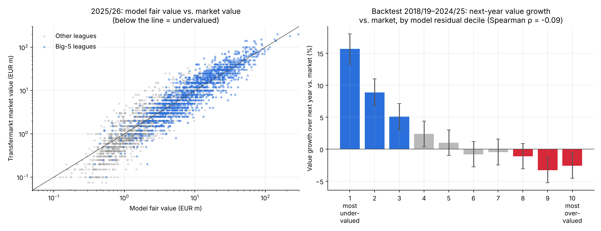
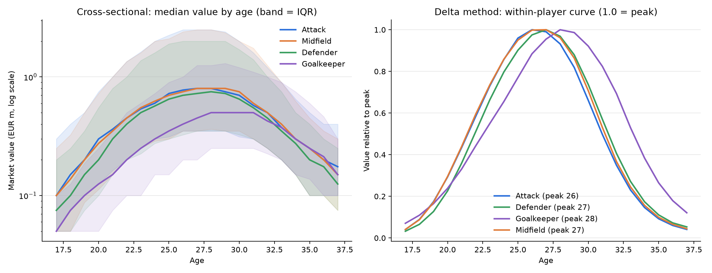
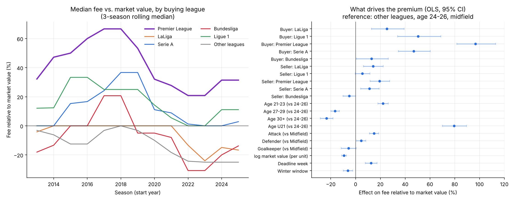
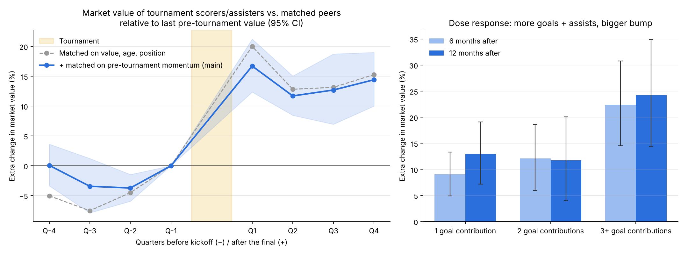
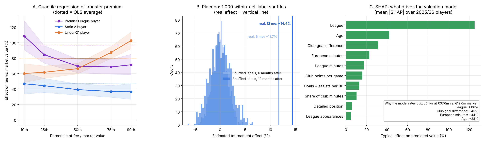

# European Football Transfer Market Analysis

Is the football transfer market rational? Using 175K transfers, 656K market valuations and 1.9M
match appearances from Transfermarkt, this project finds where clubs overpay, what moves a player's
price, and whether "undervalued" players can be identified in advance.

**[Open the interactive dashboard →](https://goathe2001.github.io/football-transfer-market/)**
Browse the scouting list with each player's value history and SHAP explanation, and explore every
chart below with filters, tooltips and table views. The scouting list can be **rebuilt from the
latest data with one click** (GitHub Actions → "Refresh scouting list" → Run workflow); the
research findings below stay fixed on the 2026-06 snapshot. The upstream dataset paused its updates
in July 2026, so the list currently reflects market values as of June 2026 and says so on the page.

## Key findings

| | Finding | Method |
|---|---|---|
| 💷 | **Premier League clubs pay ~2x** the fee-to-market-value ratio of buyers outside the big five leagues; under-21 players cost **+80%** over market value | Regression on 16K paid transfers, clustered SEs |
| 🏆 | A goal or assist at a World Cup, Euro or Copa América raises a player's value by **12–14%**, and the gain lasts at least a year | Event study, 7 tournaments, matched controls, pre-trend correction, placebo test |
| 🔎 | Players a valuation model flags as undervalued gain **+16% vs. the market** the following year; the most overvalued lose ~3% | Gradient boosting (out-of-sample R² 0.86), walk-forward backtest, SHAP |
| 📉 | Naive age curves overstate how much value a 32-year-old keeps by **~75%** (62% vs. 35% of peak for attackers) because of survivorship bias | Within-player delta method |



*Right panel: players are sorted each season by how far their market value sits below (decile 1) or
above (decile 10) the model's estimate. Undervalued players' values rise the following year;
overvalued ones fall.*

**What a club could do with this:** sell outfield players by 27–28 before value falls steeply; treat
a player's post-tournament price bump as lasting rather than a short spike; and screen leagues
outside England, where purchase premiums are lowest, using the model's undervalued list.

**Skills shown:** SQL (DuckDB) · regression with clustered standard errors and quantile regression
· event-study design, pre-trend checks and randomization inference · gradient boosting with
walk-forward validation and SHAP explanations · bias diagnosis (survivorship, selection on form,
structural breaks) · reproducible pipelines · React/TypeScript data dashboard

## Questions

1. **Age curves.** At what age does market value peak for each position, and how fast does it decline?
2. **Transfer premiums.** Do clubs pay more than market value, and does the premium depend on the
   buying league, selling league, player age, position, or transfer-window timing?
3. **Tournament effect.** Does scoring or assisting at a World Cup, Euro or Copa América raise a
   player's valuation, and does the jump last? (7 tournaments, 2014–2024)
4. **Undervalued players.** Which players are valued well below what their performance predicts,
   and does being undervalued predict future value growth?

## Data

[transfermarkt-datasets](https://github.com/dcaribou/transfermarkt-datasets) by David Cariboo:
a cleaned, weekly-refreshed export of Transfermarkt (players, valuations, transfers, appearances,
games). Downloaded as a single DuckDB file; not committed to this repo.

## Detailed findings

### 1. Age curves: the naive curve hides how fast value collapses after 30



Market value is estimated two ways. The **cross-sectional median** compares different players at
each age; it is biased by survivorship, because weaker players drop out of the data as they age and
the ones left at 32 are unusually good. The **delta method** averages each player's own year-over-year
change in log value and chains those changes, so dropouts no longer distort the shape.

| Position   | Peak age | Value kept at 30 (naive / delta) | Value kept at 32 (naive / delta) |
|------------|---------:|---------------------------------:|---------------------------------:|
| Attack     | 26       | 88% / 66%                        | 62% / **35%**                    |
| Midfield   | 27       | 94% / 71%                        | 62% / **37%**                    |
| Defender   | 27       | 87% / 74%                        | 60% / **41%**                    |
| Goalkeeper | 28       | 100% / 92%                       | 85% / **69%**                    |

Outfield players peak at 26–27 and goalkeepers about two years later. The peak age barely moves
between methods; the decline does. The naive curve says a 32-year-old attacker keeps 62% of his
peak value, while the within-player estimate is 35%. For a club, that gap is the difference between
a sensible contract extension and an expensive one.

### 2. Transfer premiums: the Premier League pays roughly double



Across 15,983 paid transfers (2012/13 onward), the median fee is 7% **below** the pre-transfer
market value, and only 42% of deals are paid above it. The overall market is not systematically
overpaying. Who is buying matters far more:

- **Premier League clubs** pay a median 33% over market value, and 70% of their purchases are above
  it. Holding seller, age, position, player value, timing and season constant, an English buyer pays
  about **+97%** relative to a club outside the big five leagues; Serie A and Ligue 1 buyers about
  +47–50%, LaLiga +25%, Bundesliga +13%.
- The English premium peaked at about +67% around 2017–2019 and has fallen to roughly +20–30% since.
- **Youth costs extra.** Under-21 players go for about +80% over market value relative to 24–26
  year olds, and 21–23 year olds about +22%; players over 30 sell at about −24%. Buyers are paying for
  potential that the market value has not yet priced in.
- **Deadline week** deals carry about +13%; winter-window deals about −6%.
- More expensive players carry a smaller premium (−9% per log unit of market value), consistent with
  market values for cheap players being noisier.

Model: OLS on log(fee / market value), standard errors clustered by buying club, season fixed
effects; R² = 0.17. Coefficients are associations, not causal effects.

### 3. Tournament effect: a goal or assist is worth about +12–14%, and it sticks



Event study across 7 tournaments (World Cups 2014/2018/2022, Euros 2016/2021/2024, Copa América
2024): 12,511 international-level player-tournaments, 662 of them with at least one goal or assist.
Each scorer or assister is compared with peers from the **same tournament, position, age band and
pre-tournament value quintile**, tracking every valuation from a year before kickoff to a year after
the final.

- **Pre-trend check.** With value, age and position matching alone, future scorers were already
  rising about 5–8% faster in the year before the tournament: they were in form, so a naive
  comparison would credit the tournament with growth that was already happening. Adding
  **pre-tournament momentum** to the matching removes most of this (the 6–12 month pre-period
  differences become statistically indistinguishable from zero); a small run-up of about 4% remains
  in the final six months before kickoff.
- **Effect.** With that correction, scorers and assisters gain an extra **+17%** in the first
  quarter after the final, settling at **+12%** after six months and **+14%** after a year. The
  bump does not fade within twelve months.
- **Dose response.** One or two goal contributions are worth about +9–13%; three or more about
  **+22–24%**.

Model: for each quarter of event time, OLS of the log change from the last pre-tournament value on a
treatment indicator, with matching-cell fixed effects and standard errors clustered by player.

### 4. Undervalued players: the model's "bargains" really do appreciate


A gradient-boosting model predicts each player's season-end market value from that season's
performance: league minutes and share of club minutes, goals and assists per 90, European minutes and
output, club points and goal difference per game, league, age, position, height and foot. It is
trained on 50,113 player-seasons (at least 900 league minutes, 2012/13–2025/26), with the target
defined relative to each season's median so market inflation does not leak in.

- **Walk-forward validation.** Each season from 2018/19 is predicted by a model trained only on
  earlier seasons. Out-of-sample R² is **0.81–0.86** (linear baseline 0.80–0.85); the median
  prediction is within about 45% of the actual value.
- **Backtest.** If the residual (actual minus predicted) captures real mispricing, undervalued
  players should catch up. They do: across 23,348 player-seasons, the most undervalued decile gained
  **+16%** relative to the market over the following year and the most overvalued decile lost about
  3%, with a near-monotone pattern in between. The gap holds within every age band (≤23: +36
  points, 24–27: +27, 28+: +19 between the bottom and top fifths), so it is not just young players growing.
- **2025/26 scouting list** (`outputs/04_undervalued_2025_26.csv`): players aged 26 or under with
  at least 1,500 league minutes and a value of at least EUR 1m, ranked by how far their market value
  sits below the model's estimate. Russian and Ukrainian league players are left off the list: their
  values have been structurally lower since 2022, a break the model cannot learn from earlier seasons,
  so they would appear as false bargains. Excluding them leaves the backtest unchanged (decile 1
  +15.5%, decile 10 −2.2%).

The list is a starting point for scouting, not a verdict. The model sees only goals, assists, minutes
and team context, so it cannot judge defensive quality, injuries or contract situations.

### 5. Robustness and interpretability



**A. Is the Premier League premium driven by a few blockbuster overpays? No.** Quantile regression
re-estimates the premium model at different points of the fee-to-value distribution. The English
premium is largest at the **bottom** of the distribution (+108% at the 10th percentile vs. about
+70% from the median up): English clubs rarely get a bargain, rather than occasionally overpaying
wildly. The youth premium works the other way, rising from +60% at the 10th percentile to +103% at
the 90th, so the biggest overpays are concentrated on young players.

**B. Could the tournament effect be an artefact of the matching? No.** The "scored or assisted"
label was shuffled among players within the same matching cell 1,000 times and the effect
re-estimated each time. The shuffled estimates centre on 0% and never exceed +4.6% (6 months) or
+6.6% (12 months), against real effects of +11.7% and +14.4% (permutation p = 0.001, the smallest
possible with 1,000 draws).

**C. What does the valuation model actually use? Mostly context.** SHAP values (from an equivalent
LightGBM model: same R² of 0.86, residuals correlated 0.99 with the step-4 model) show that
**league** dominates (typical effect on predicted value about ±125%), followed by age (±42%) and
team quality: club goal difference (±32%) and European minutes (±23%). Individual output (goals and
assists per 90) matters less (±13%). This explains the scouting list: the top names are mostly
regular starters at strong clubs in strong leagues whose market values have not caught up with that
context. For example, Villarreal goalkeeper Luiz Júnior (market value €12m, model €38m) is lifted by
LaLiga (+161%), Villarreal's goal difference (+45%) and Champions League minutes (+44%).

## Run it

```bash
pip install -r requirements.txt
bash data/download.sh              # ~ downloads data/transfermarkt.duckdb
python analysis/00_inspect.py      # tables, columns, fee coverage
python analysis/01_age_curves.py   # add --big5 for top-5 leagues only
python analysis/02_transfer_premium.py
python analysis/03_world_cup_effect.py
python analysis/04_undervalued.py
python analysis/05_robustness.py
python analysis/06_export_dashboard.py   # research JSON for the dashboard (frozen)
python analysis/07_refresh_scouting.py   # scouting-list JSON (run on demand in CI)

cd dashboard && npm install && npm run dev   # local dashboard at http://localhost:5173
```

Results are exactly reproducible: the SQL breaks every tie explicitly and the scripts fix row order
and random seeds.

The main SQL lives in `sql/` (`02_paid_transfers.sql`, `03_tournament_panel.sql`,
`04_player_seasons.sql`).

## Repository layout

```
data/       download script (database itself is git-ignored)
sql/        main queries (DuckDB)
analysis/   one script per question, numbered in order
figures/    charts produced by the scripts
outputs/    CSV tables produced by the scripts
dashboard/  React + TypeScript + Recharts dashboard, deployed to GitHub Pages by
            .github/workflows/deploy-dashboard.yml; the scouting list is rebuilt on demand
            by .github/workflows/refresh-scouting.yml
```

## Limitations

- Transfermarkt market values are community estimates, not observed prices.
- Free transfers, loans and loan returns are all stored with a fee of 0 and cannot be separated, so
  the premium analysis covers paid transfers only. Fees are sparse before 2012/13.
- About 6% of paid transfers have a fee exactly equal to market value, likely because Transfermarkt
  editors anchor valuations on reported fees. This pulls small-group medians toward 0%.
- Contract length at the time of a transfer is not in the data (only each player's current
  contract), so its effect on fees cannot be estimated here.
- "Other leagues" mixes many markets, including ones outside the dataset's tracked leagues.
- Tournament squads and minutes are only recorded for 2026, so earlier tournaments identify
  players by goal events (scorers and assisters) and use international caps (current snapshot) to
  define the comparison pool. The control group therefore includes some players who were not at the
  tournament, and the estimate combines "played well" with "was selected and played".
- The 2026 World Cup cannot be analysed yet: valuations in this snapshot end on 2026-06-12.
- Performance data is limited to goals, assists, minutes and cards (no expected-goals data).

## Data credit

Data from Transfermarkt via [transfermarkt-datasets](https://github.com/dcaribou/transfermarkt-datasets).
